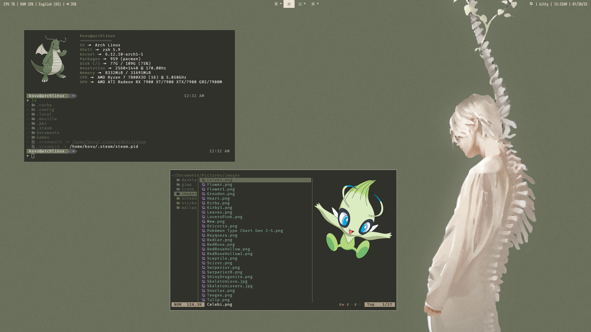
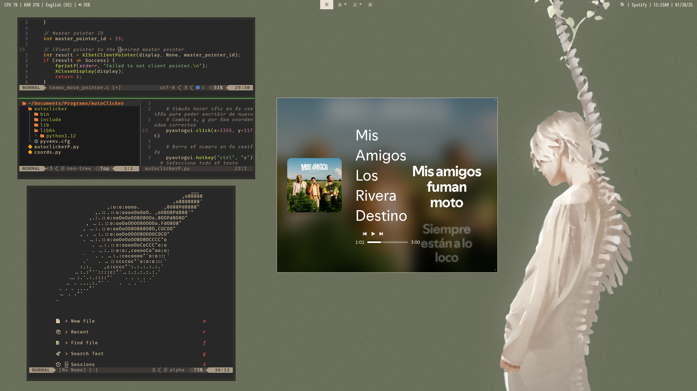

# Green Moss Dotfiles




## Palette

| Role       | Color |
| ---------- | ------ |
| Background | `#10120e` |
| Foreground | `#f3ece4` |
| Accent     | `#A3B18A` |
| Selection  | `#666b57` |


## Included

Files are grouped by session: `common/` works in any session, `x11/` is the
bspwm session, `wayland/` the Hyprland one (in progress).

- `common/`
  - `rofi` - Launcher and power menu (with a theme picker)
  - `kitty` - Terminal
  - `dunst` - Notifications
  - `fish` - Shell, tide prompt and functions
  - `nvim` - Neovim (lazy.nvim, noirbuddy)
  - `yazi` - File manager
  - `themes/green_moss` - This preset's colors and wallpapers; `themes/current` points at it
  - `scripts` - `theme.sh` (switch presets), `build-gtk-theme.sh` (recolored Orchis GTK theme)
- `x11/`
  - `bspwm` / `sxhkd` - Window manager and keybindings
  - `polybar` - Status bar
  - `picom` - Compositor (v13 animations; extra `picom.conf.*` variants)
  - `scripts` - `wallpaper.sh`, `restartpicom.sh`

## Installation

Clone the repository and copy/link the folders inside each group into
`~/.config/`, and each group's `scripts/` into `~/Documents/scripts/<group>/`.

```sh
git clone https://github.com/iiKovu/dotfiles-green-moss.git
cd dotfiles-green-moss
```

Wallpaper paths are set in `common/themes/green_moss/preset.sh`.
